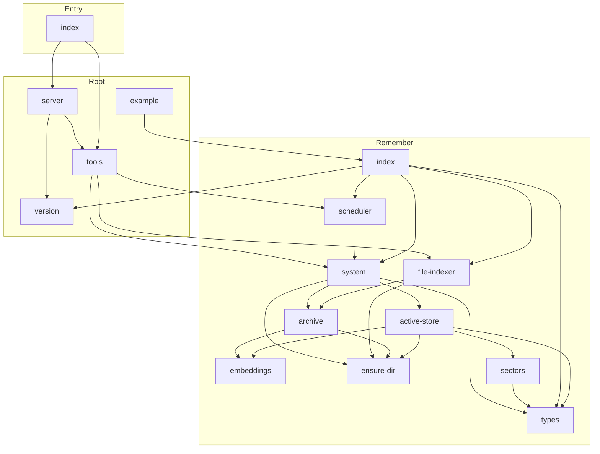

<!-- repo-map:no-verification -->
<!-- GENERATED FILE -- do not edit by hand.
     Regenerate with `repo-tools map`. -->

# remember-mcp - Dependency Graph

**Version**: 2.0.0

This document provides a comprehensive dependency graph of all files, components, imports, functions, and variables in the codebase.

---

## Table of Contents

1. [Overview](#overview)
2. [Package Dependencies](#package-dependencies)
3. [Root Dependencies](#root-dependencies)
4. [Entry Dependencies](#entry-dependencies)
5. [Remember Dependencies](#remember-dependencies)
6. [Dependency Matrix](#dependency-matrix)
7. [Circular Dependency Analysis](#circular-dependency-analysis)
8. [Visual Dependency Graph](#visual-dependency-graph)
9. [Summary Statistics](#summary-statistics)

---

<a id="overview"></a>
## Overview

The codebase is organized into the following modules:

- **root**: 4 files
- **entry**: 1 file
- **remember**: 10 files

---

<a id="root-dependencies"></a>

## Root Dependencies

### `src/example.ts` - Example usage of remember-mcp hybrid memory system (Bun).

**Internal Dependencies:**
| File | Imports | Type |
|------|---------|------|
| `./remember/index.ts` | `RememberSystem` | Import |

---

### `src/server.ts` - server module

**External Dependencies:**
| Package | Import |
|---------|--------|
| `@modelcontextprotocol/server` | `McpServer, fromJsonSchema, JsonSchemaType` |

**Internal Dependencies:**
| File | Imports | Type |
|------|---------|------|
| `./tools.ts` | `HANDLERS, TOOLS` | Import |
| `./version.ts` | `PKG_VERSION` | Import |

**Exports:**
- Functions: `buildServer`

---

### `src/tools.ts` - MCP tool definitions and handlers for remember-mcp.

**External Dependencies:**
| Package | Import |
|---------|--------|
| `@modelcontextprotocol/server` | `Tool` |

**Internal Dependencies:**
| File | Imports | Type |
|------|---------|------|
| `./remember/file-indexer.ts` | `FileIndexer` | Import |
| `./remember/scheduler.ts` | `ArchivalScheduler` | Import |
| `./remember/system.ts` | `RememberSystem` | Import |

**Exports:**
- Types: `ToolHandler`
- Functions: `setup`, `shutdown`, `listRegisteredToolNames`
- Constants: `TOOLS`, `HANDLERS`

---

### `src/version.ts` - version module

**Exports:**
- Constants: `PKG_VERSION`, `PKG_NAME`

---

<a id="entry-dependencies"></a>

## Entry Dependencies

### `src/index.ts` - Main MCP server entry for remember-mcp (Bun + TypeScript).

**External Dependencies:**
| Package | Import |
|---------|--------|
| `@modelcontextprotocol/server` | `LATEST_PROTOCOL_VERSION` |
| `@modelcontextprotocol/server/stdio` | `serveStdio` |

**Internal Dependencies:**
| File | Imports | Type |
|------|---------|------|
| `./server.ts` | `buildServer` | Import |
| `./tools.ts` | `shutdown` | Import |

---

<a id="remember-dependencies"></a>

## Remember Dependencies

### `src/remember/active-store.ts` - Active memory store backed by bun:sqlite.

**External Dependencies:**
| Package | Import |
|---------|--------|
| `bun:sqlite` | `Database` |

**Node.js Built-in Dependencies:**
| Module | Import |
|--------|--------|
| `path` | `dirname` |
| `crypto` | `randomUUID` |

**Internal Dependencies:**
| File | Imports | Type |
|------|---------|------|
| `./ensure-dir.ts` | `ensureDir` | Import |
| `./embeddings.ts` | `blobToEmbedding, cosine, embed, embeddingToBlob` | Import |
| `./sectors.ts` | `classifySectors` | Import |
| `./types.ts` | `SectorType` | Import (type-only) |

**Exports:**
- Classes: `ActiveStore`
- Interfaces: `ActiveMemoryRow`, `AddMemoryResult`

---

### `src/remember/archive.ts` - QR-video archive helpers (TypeScript memvid stand-in).

**External Dependencies:**
| Package | Import |
|---------|--------|
| `qrcode` | `default` |

**Node.js Built-in Dependencies:**
| Module | Import |
|--------|--------|
| `fs` | `mkdtempSync, readFileSync, renameSync, rmSync, writeFileSync, existsSync, unlinkSync, statSync` |
| `os` | `tmpdir` |
| `path` | `dirname, join` |
| `child_process` | `spawnSync` |

**Internal Dependencies:**
| File | Imports | Type |
|------|---------|------|
| `./embeddings.ts` | `cosine, embed` | Import |
| `./ensure-dir.ts` | `ensureDir` | Import |

**Exports:**
- Interfaces: `ArchiveChunk`, `ArchiveSidecar`, `EncodeResult`
- Functions: `removeArchiveOutputs`, `encodeChunks`, `loadSidecar`, `sidecarChunkCount`, `searchSidecar`

---

### `src/remember/embeddings.ts` - Lightweight, dependency-free embedding provider.

**Exports:**
- Functions: `embed`, `cosine`, `embeddingToBlob`, `blobToEmbedding`

---

### `src/remember/ensure-dir.ts` - Folder creation that accepts a folder that already exists.

**Node.js Built-in Dependencies:**
| Module | Import |
|--------|--------|
| `fs` | `mkdirSync, statSync` |

**Exports:**
- Functions: `ensureDir`

---

### `src/remember/file-indexer.ts` - File indexing via QR-encoded video storage.

**Node.js Built-in Dependencies:**
| Module | Import |
|--------|--------|
| `crypto` | `createHash` |
| `fs` | `existsSync, readFileSync, renameSync, statSync, writeFileSync` |
| `os` | `homedir` |
| `path` | `basename, extname, isAbsolute, join, relative, resolve` |

**Internal Dependencies:**
| File | Imports | Type |
|------|---------|------|
| `./archive.ts` | `encodeChunks, searchSidecar` | Import |
| `./ensure-dir.ts` | `ensureDir` | Import |

**Exports:**
- Classes: `FileIndexer`
- Interfaces: `FileIndexerOptions`

---

### `src/remember/index.ts` - Package entry point for remember (re-exports 9 symbols)

**Internal Dependencies:**
| File | Imports | Type |
|------|---------|------|
| `./system.ts` | `RememberSystem` | Re-export |
| `./file-indexer.ts` | `FileIndexer` | Re-export |
| `./scheduler.ts` | `ArchivalScheduler` | Re-export |
| `./types.ts` | `MemoryLocation, HybridMemoryResult, ArchiveStats, SystemStats, SectorType` | Re-export |
| `../version.ts` | `PKG_VERSION` | Re-export |

**Exports:**
- Re-exports:

  ```text
  RememberSystem, FileIndexer, ArchivalScheduler, MemoryLocation, HybridMemoryResult, ArchiveStats,
  SystemStats, SectorType, VERSION
  ```


---

### `src/remember/scheduler.ts` - Background scheduler for automatic memory archival.

**Internal Dependencies:**
| File | Imports | Type |
|------|---------|------|
| `./system.ts` | `RememberSystem` | Import (type-only) |

**Exports:**
- Classes: `ArchivalScheduler`

---

### `src/remember/sectors.ts` - Keyword-heuristic sector classifier.

**Internal Dependencies:**
| File | Imports | Type |
|------|---------|------|
| `./types.ts` | `SECTORS, SectorType` | Import |

**Exports:**
- Functions: `classifySectors`

---

### `src/remember/system.ts` - RememberSystem — hybrid active (SQLite) + archive (QR video) manager.

**Node.js Built-in Dependencies:**
| Module | Import |
|--------|--------|
| `crypto` | `createHash` |
| `fs` | `existsSync, readdirSync, statSync` |
| `path` | `basename, extname, join` |

**Internal Dependencies:**
| File | Imports | Type |
|------|---------|------|
| `./active-store.ts` | `ActiveStore` | Import |
| `./ensure-dir.ts` | `ensureDir` | Import |
| `./archive.ts` | `encodeChunks, searchSidecar, sidecarChunkCount` | Import |
| `./types.ts` | `ArchiveIndex, ArchiveInfo, ArchiveStats, HybridMemoryResult, MemoryLocation, SystemStats` | Import |

**Exports:**
- Classes: `RememberSystem`
- Interfaces: `RememberSystemOptions`
- Constants: `MAX_CONTENT_CHARS`, `MAX_QUERY_K`

---

### `src/remember/types.ts` - Overall system statistics.

**Exports:**
- Interfaces: `HybridMemoryResult`, `ArchiveStats`, `SystemStats`, `ArchiveInfo`
- Types: `SectorType`, `ArchiveIndex`
- Enums: `MemoryLocation`
- Constants: `SECTORS`

---

<a id="dependency-matrix"></a>
## Dependency Matrix

### File Import/Export Matrix

| File | Imports From | Exports To |
|------|--------------|------------|
| `src/remember/system` | 4 files | 3 files |
| `src/remember/index` | 5 files | 1 file |
| `src/remember/active-store` | 4 files | 1 file |
| `src/tools` | 3 files | 2 files |
| `src/remember/archive` | 2 files | 2 files |
| `src/remember/ensure-dir` | 0 files | 4 files |
| `src/remember/file-indexer` | 2 files | 2 files |
| `src/remember/types` | 0 files | 4 files |
| `src/remember/scheduler` | 1 file | 2 files |
| `src/server` | 2 files | 1 file |
| `src/index` | 2 files | 0 files |
| `src/remember/embeddings` | 0 files | 2 files |
| `src/remember/sectors` | 1 file | 1 file |
| `src/version` | 0 files | 2 files |
| `src/example` | 1 file | 0 files |

---

<a id="circular-dependency-analysis"></a>
## Circular Dependency Analysis

**No circular dependencies detected.**
---

<a id="visual-dependency-graph"></a>
## Visual Dependency Graph



---

<a id="summary-statistics"></a>
## Summary Statistics

| Category | Count |
|----------|-------|
| Total Source Files | 27 |
| Subsystems | 3 |
| Total Lines of Code | 4019 |
| Total Exports | 58 |
| Total Re-exports | 9 |
| Total Classes | 4 |
| Total Interfaces | 11 |
| Total Functions | 18 |
| Total Type Guards | 0 |
| Total Enums | 1 |
| Type-only Imports | 3 |
| Runtime Cyclic Components | 0 |
| Type-only Cyclic Components | 0 |
| Files in Runtime Cycles | 0 |
| Files in Type-only Cycles | 0 |

---

*Version*: 2.0.0
